# Plain Craft Launcher N（PCL-N）

一个用 **Electron + Node.js** 从零实现的 Minecraft 启动器，界面与交互参考 **PCL2 CE（Plain Craft Launcher 2 社区版）**。
不依赖任何第三方启动核心：版本解析、依赖库规则、资源索引、加载器安装、Modrinth 下载、整合包安装、崩溃分析全部自己实现。

> 本项目用于学习交流，与 PCL2 官方无关，也不包含 PCL2 的任何代码或资源。
>
> 仓库：<https://github.com/CsOH-Lawrence/PCL-N> · 许可证：MIT

---

## 功能一览

| 模块 | 能力 |
| --- | --- |
| 游戏安装 | 原版全版本（正式版 / 快照 / 远古版本）、客户端 jar、依赖库规则（os/arch/features）、natives 解压、资源索引与 4000+ 资源文件、资源完整性校验与修复 |
| 加载器 | Fabric、Quilt（官方 meta profile）、Forge、NeoForge（官方安装器，自动准备 `launcher_profiles.json`、匹配 Java） |
| 整合包 | Modrinth `.mrpack`（含 overrides / client-overrides）、CurseForge `manifest.json`（**无需 API Key**，自动走官网接口下载模组）、通用 zip / PCL 导出的压缩包；自动创建**版本隔离**的独立目录 |
| 模组 | Modrinth 搜索、版本筛选（游戏版本 + 加载器）、一键安装并**自动补齐前置依赖**、本地模组启用 / 禁用（重命名 `.disabled`）、删除、元数据解析（Fabric / Quilt / Forge / NeoForge 四种描述文件） |
| 资源包 / 光影 / 数据包 | Modrinth 分类搜索与安装，自动放入 `resourcepacks` / `shaderpacks` / `datapacks`（数据包可指定存档） |
| Java | 扫描注册表与常见目录、读取 `java -XshowSettings` 版本信息、按游戏版本自动匹配、Adoptium 下载 JRE 并解压到启动器目录 |
| 启动 | 完整 JVM / 游戏参数构建（含版本 JSON 的 `arguments` 规则、`${}` 变量、log4j 配置）、离线 UUID、内存与 GC 预设、自定义 JVM / 游戏参数、日志落盘、进程退出码 |
| 账号与自动登录 | 多账号管理：**离线账号**（自定义名字）与**微软正版账号**（内嵌官方登录页完成 OAuth，令牌保存在本机并自动续期）；开启「启动时自动登录」后启动器打开即恢复上次账号，启动游戏前自动刷新过期令牌 |
| 错误帮助 | 30 条崩溃规则（内存、Java 版本、模组冲突、Mixin、OpenGL、虚拟机、文件损坏等），解析 crash-report / latest.log，给出**简略帮助与解决建议**，并提供错误百科 |
| 下载源 | Mojang 官方 / BMCLAPI 镜像自动回退、SHA1 校验、断点重试、并发下载与实时速度 |
| 界面 | PCL 风格无边框窗口、自定义标题栏、版本卡片、下载页、设置页、任务进度条、Toast、模态框 |

---

## 界面预览

| 主页 | 版本设置 |
| --- | --- |
| 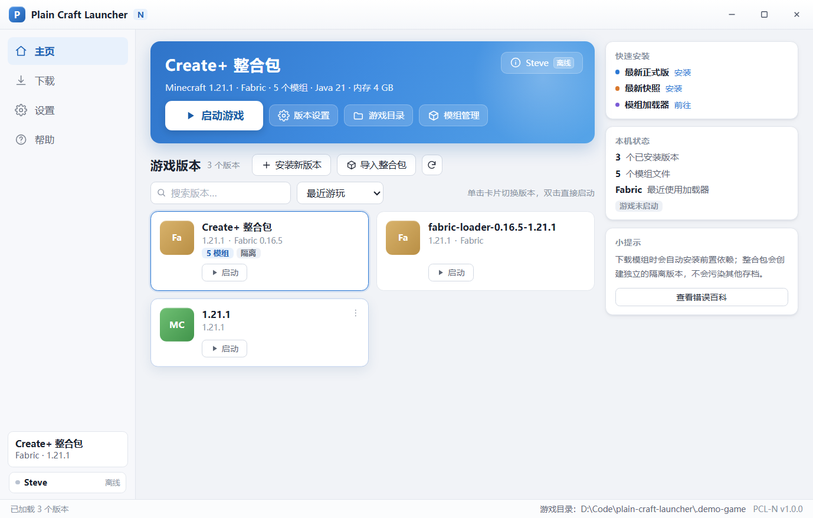 | 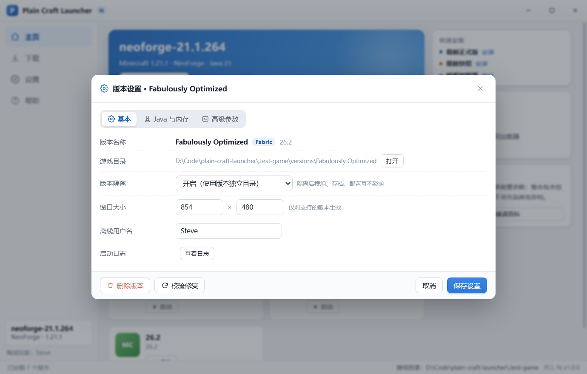 |

| 下载游戏版本 | 加载器 |
| --- | --- |
| 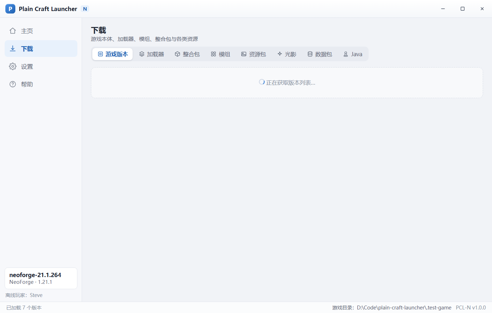 | 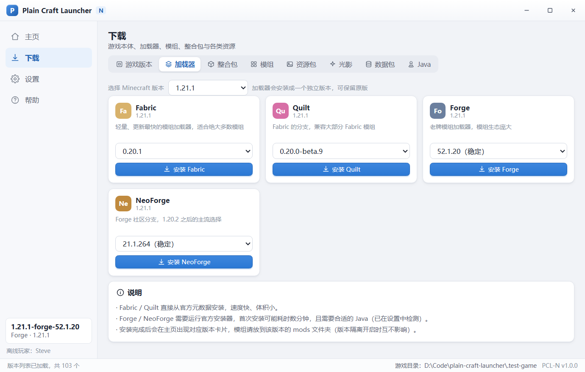 |

| 整合包 | 模组 |
| --- | --- |
| 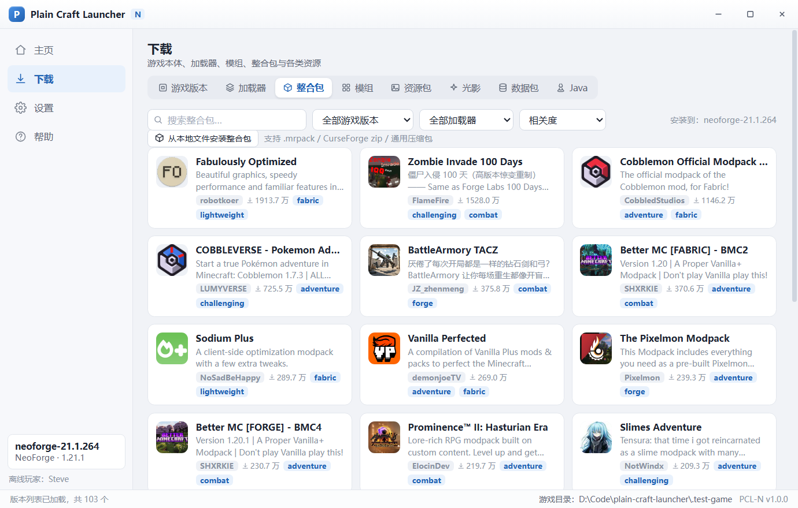 | 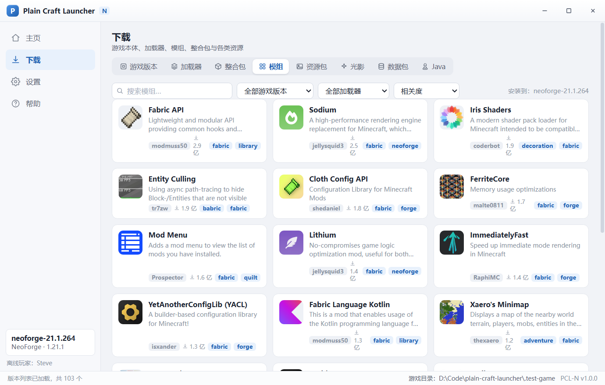 |

| 内容管理 | 崩溃分析 |
| --- | --- |
| 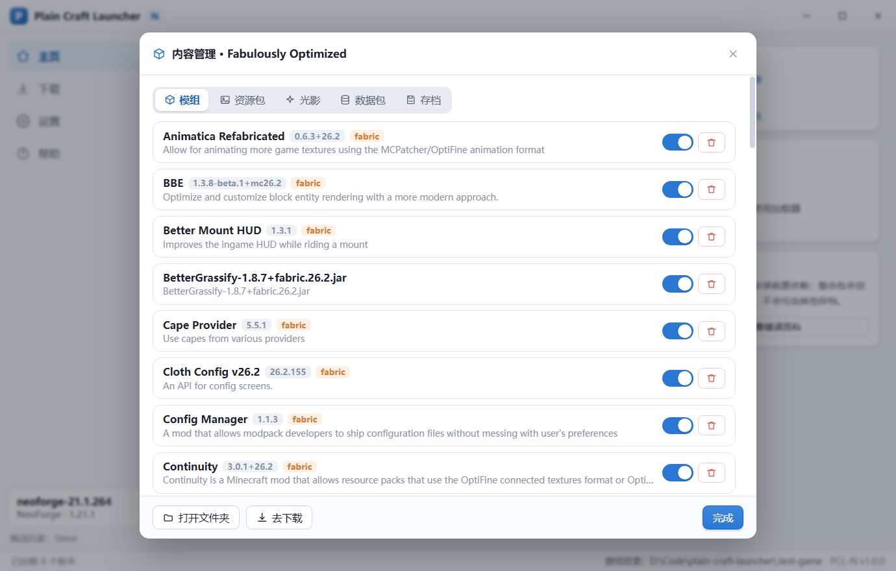 | 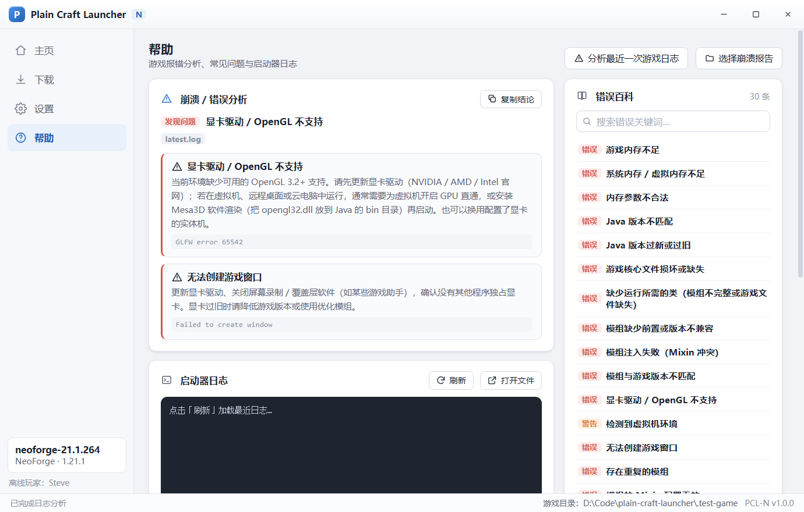 |

| 启动设置 | Java 管理 |
| --- | --- |
| 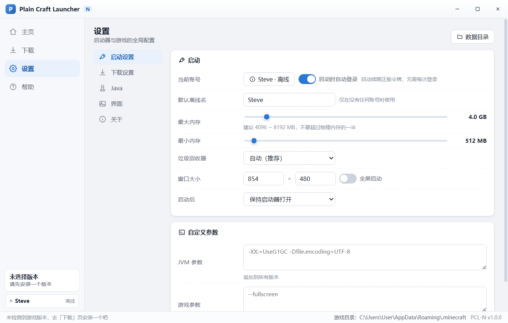 | 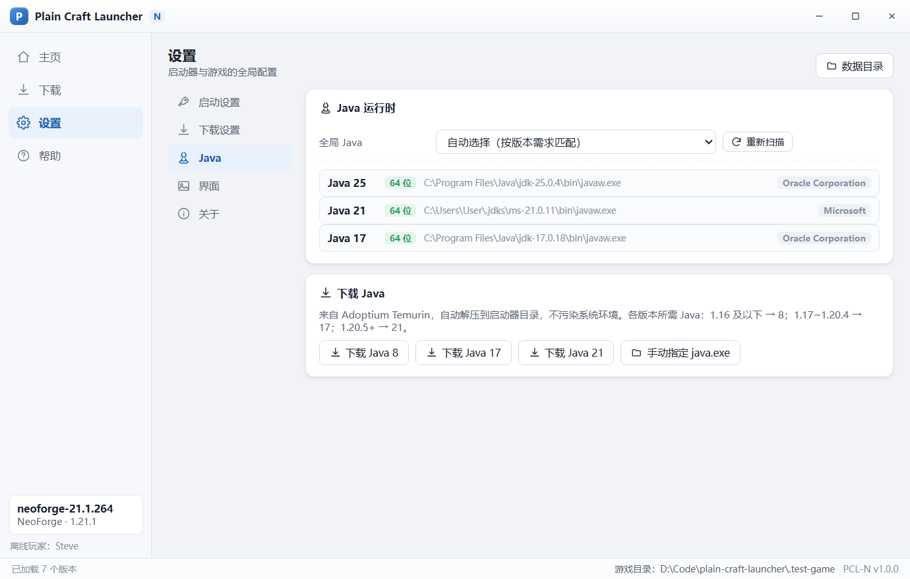 |

| 下载设置（CurseForge 免 Key） |
| --- |
| 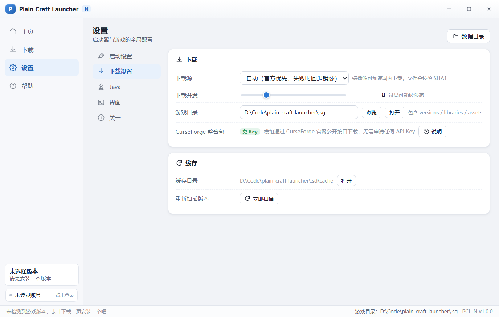 |

| 账号与自动登录 | 微软官方登录页 |
| --- | --- |
| 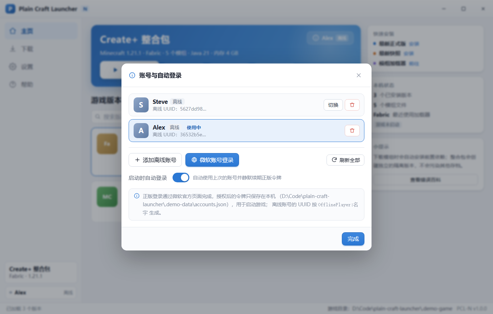 | 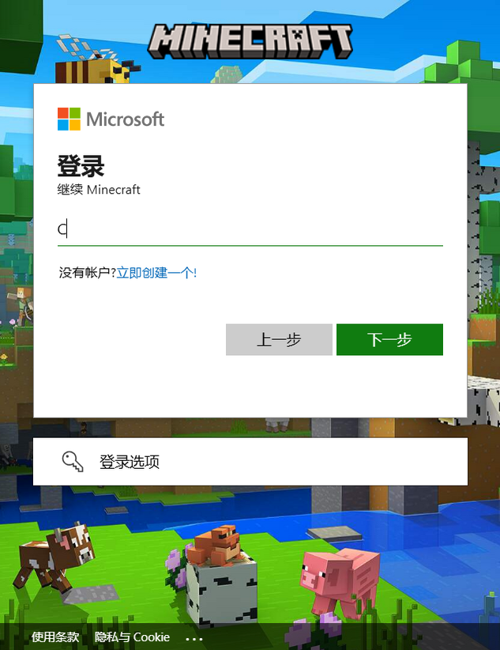 |

---

## 账号与自动登录

启动器启动时会读取 `账号` 面板里的账号列表，`自动登录` 打开时：

1. 启动器打开后自动选中上次使用的账号；
2. 如果该账号是微软正版且令牌将过期，后台静默用 `refresh_token` 续期（不会弹窗）；
3. 点「启动游戏」前再检查一次，令牌失效会提示「请重新登录」，不会带着过期令牌启动。

**添加离线账号**：账号管理 → 添加离线账号，输入 1~16 位名字，UUID 按 `OfflinePlayer:名字` 生成（与 PCL 一致）。

**微软正版登录**：账号管理 → 微软账号登录，会弹出一个内嵌的微软官方登录窗口（Minecraft 主题，见截图）；
在窗口里完成邮箱 + 密码 + 验证码后，启动器自动走完
`Xbox Live → XSTS → Minecraft Services → 档案查询`，拿到正版会话并写入账号列表。
令牌只保存在本机 `%APPDATA%\PlainCraftLauncher\accounts.json`（文件权限 0600），不会上传到任何第三方服务器。

> 微软账号需要**已购买 Minecraft**；没有 Xbox 账号、未成年账号未加入家庭组等情况会给出对应中文提示。

---

## CurseForge 整合包（不需要任何 Key）

启动器**不使用、也不需要 CurseForge API Key**，而是直接调用 CurseForge 官网公开的网页接口：

```
GET https://www.curseforge.com/api/v1/mods/{projectID}/files/{fileID}           → 文件名、大小
GET https://www.curseforge.com/api/v1/mods/{projectID}/files/{fileID}/download  → 302 到 CDN，返回文件
```

整合包 `manifest.json` 里只有 `projectID / fileID`，正好够用；下载来源和你用浏览器点「Download」完全一致，
所以既不需要注册开发者账号，也不需要把任何密钥写进配置文件。

少数作者在 CurseForge 上关闭了「第三方下载」，这类文件会自动跳过，安装结束时会提示数量，
你可以在 CurseForge 网页手动下载后放进该整合包版本的 `mods` 文件夹；也可以直接下载整合包 zip，
用主页的「导入整合包」安装。

Modrinth 的整合包 / 模组走 Modrinth 官方开放接口，同样不需要账号或 Key。

---

## 快速开始

```bash
# 1. 安装依赖（只需一次）
pnpm install

# 2. 启动
pnpm start
```

Windows 下也可以直接双击 **`启动 PCL-N.bat`**。

首次启动会在 `%APPDATA%\PlainCraftLauncher` 生成配置与日志，默认游戏目录为 `%APPDATA%\.minecraft`，
可在「设置 - 下载设置 - 游戏目录」中改到任意位置。

### 运行环境

- Node.js 20+（开发）/ Electron 38（已随依赖安装）
- 需要 Java 才能启动游戏：可在「设置 - Java」中一键下载 Java 8 / 17 / 21

---

## 打包成安装包

这是 Electron 项目，**没有 gradlew，也不会产出 jar**（jar 是 Java 的产物）。等价的分发方式是 electron-builder：

```bash
pnpm install
pnpm dist:win            # Windows x64 单文件绿色版 exe
pnpm dist:win-installer  # Windows x64 NSIS 安装包
pnpm dist:mac            # macOS 通用 dmg + zip（需在 macOS 上执行）
```

产物在 `dist/`：`PCL-N-1.0.0-win-x64-portable.exe`、`PCL-N-1.0.0-win-x64-setup.exe`、`PCL-N-1.0.0-mac-universal.dmg` 等。
便携版的配置 / 账号 / 缓存会写在 exe 同级的 `PCL-N-Data` 文件夹里，拷走即可迁移。
macOS 的包无法在 Windows 上交叉编译，仓库自带 GitHub Actions 工作流
（`.github/workflows/build.yml`），推 tag 后会自动产出 Windows / macOS / Linux 三个平台的 artifact。

详细说明见 [BUILD.md](BUILD.md)。

---

## 目录结构

```
plain-craft-launcher/
├─ src/
│  ├─ main/            # Electron 主进程：窗口、IPC、事件转发
│  │  ├─ main.js
│  │  └─ ipc.js
│  ├─ preload/         # contextBridge 安全桥
│  ├─ core/            # 与界面无关的启动器内核（纯 Node，可单测）
│  │  ├─ paths.js      # 数据目录 / 游戏目录
│  │  ├─ config.js     # 配置读写与版本级设置
│  │  ├─ log.js        # 日志（文件 + 环形缓冲 + 事件）
│  │  ├─ tasks.js      # 任务中心（进度 / 速度 / 取消）
│  │  ├─ http.js       # 下载器：镜像回退、重试、SHA1、并发
│  │  ├─ zip.js        # 自研 ZIP 读取（含 ZIP64）
│  │  ├─ mojang.js     # 版本清单、inheritsFrom 合并、规则判定、依赖解析
│  │  ├─ install.js    # 原版安装 / 校验修复 / natives / 老版本资源映射
│  │  ├─ loaders.js    # Fabric / Quilt / Forge / NeoForge
│  │  ├─ java.js       # Java 检测与下载
│  │  ├─ auth.js       # 账号：离线 / 微软正版 OAuth、令牌刷新（自动登录）
│  │  ├─ launch.js     # 启动参数构建与进程管理
│  │  ├─ versions.js   # 本地版本扫描、模组 / 资源包 / 存档管理
│  │  ├─ modrinth.js   # Modrinth API 封装
│  │  ├─ curseforge.js # CurseForge 文件查询与下载（官网公开接口，无需 Key）
│  │  ├─ modpack.js    # 三种整合包格式安装
│  │  └─ crash.js      # 崩溃与错误分析规则库
│  └─ renderer/        # 界面（原生 HTML/CSS/JS，无打包步骤）
│     ├─ index.html
│     ├─ style.css
│     └─ js/{icons,core,accounts,home,download,settings,help,app}.js
├─ scripts/            # 自测与工具脚本
│  ├─ test-core.js     # 元数据 / 安装 / 启动自测
│  ├─ test-auth.js     # 账号与自动登录自测
│  ├─ test-modpack.js  # 整合包安装自测
│  ├─ test-cf-pack.js  # CurseForge 整合包安装自测（免 Key）
│  ├─ make-demo.js     # 生成演示版本目录（截图用）
│  ├─ check-ms-login.js# 打开微软登录页并截图
│  └─ make-icon.py     # 生成应用图标
├─ assets/icon.png
└─ 启动 PCL-N.bat
```

---

## 一些实现细节

**版本 JSON 继承与规则**
`inheritsFrom` 按官方语义合并：`libraries` 与 `arguments.game/jvm` 父在前、子在后，标量由子覆盖；
规则判定支持 `os.name / os.arch / os.version / features`，因此 1.13+ 的 `-cp ${classpath}`、
1.17+ 的 `--add-opens`、以及老版本的 natives classifier 都能正确展开。

**下载与镜像**
`http.js` 会把 `libraries.minecraft.net`、`resources.download.minecraft.net`、`piston-meta.mojang.com` 等
自动映射到 BMCLAPI；「自动」模式下官方失败后回退镜像。所有文件带 SHA1 校验，失败重试，
下载任务共享一个进度/速度模型（`tasks.js`），界面底部实时显示。

**整合包安装**
`.mrpack` 会读取 `modrinth.index.json` 的 `dependencies` 先安装对应原版 + 加载器，再建一个
`versions/<整合包名>/<整合包名>.json`（`inheritsFrom` 指向加载器版本）并默认开启版本隔离，
模组、配置、存档都放进这个目录，互不污染。文件按 `path` 落盘并校验 SHA1，`overrides/` 与
`client-overrides/` 分别解压。

**崩溃帮助**
`crash.js` 内置 30 条规则，对 crash-report、`latest.log`、启动器日志逐个正则匹配，
命中的规则会输出「问题 + 证据 + 解决建议」，并额外提取 Java 版本、内存、退出码与可疑模组名。
游戏异常退出时界面会弹出分析结论，也可在「帮助」页手动分析任意日志文件。

---

## 自测

```bash
# 元数据 / 搜索 / 崩溃分析 / Java 检测（不下载游戏）
node scripts/test-core.js meta 1.21.1

# 完整安装原版（约 400MB 资源 + 依赖库）
node scripts/test-core.js install 1.21.1

# 只构建启动命令，不启动进程
node scripts/test-core.js launch 1.21.1

# 账号与自动登录（离线账号、启动参数注入、微软接口连通性）
node scripts/test-auth.js

# CurseForge 整合包安装（免 Key，会真实下载一个模组）
node scripts/test-cf-pack.js

# 真正启动游戏（需要显卡支持 OpenGL）
node scripts/test-core.js run 1.21.1

# 安装整合包（默认 Fabulously Optimized，可传 Modrinth slug）
node scripts/test-modpack.js fabulously-optimized
```

测试默认使用项目内的 `.test-game` / `.test-data`，不会动到真实 `.minecraft`。

---

## 已知限制

- 登录支持**离线账号**与**微软正版账号**；authlib-injector 外置登录（第三方皮肤站账号）未实现。
- 联机房间（PCL 的「联机」页）按需求不做。
- CurseForge 整合包默认走官网接口下载模组，**不需要 API Key**；个别作者关闭了第三方下载的文件会跳过，需要手动下载后放进 `mods`。
- OptiFine 需要人工下载安装包，未做自动安装。
- 游戏窗口大小通过 `--width/--height` 传入，个别版本会以 `options.txt` 为准。

## 常见问题

**Q：为什么启动到一半就退出，日志里写着 `GLFW error 65542: WGL: The driver does not appear to support OpenGL`？**
说明当前系统没有可用的 OpenGL 3.2+。虚拟机 / 远程桌面 / 云电脑默认不提供 3D 加速：
在虚拟机里开启 3D 加速或 GPU 直通，或者把 Mesa3D 的 `opengl32.dll` 放到 Java 的 `bin` 目录下走软件渲染。
「帮助」页的崩溃分析会自动识别这条错误并给出同样的建议。

**Q：`pnpm install` 之后启动报 “Electron failed to install correctly”？**
pnpm 默认会跳过依赖的构建脚本，本项目已在 `package.json` 的 `pnpm.onlyBuiltDependencies` 中允许 electron；
若仍然出现，执行 `pnpm run setup`（等价于 `node node_modules/electron/install.js`）手动补装二进制。

**Q：启动器一闪而过？**
如果是从某个设置了 `ELECTRON_RUN_AS_NODE=1` 的终端里启动，Electron 会以纯净 Node 模式运行。项目自带的
`启动 PCL-N.bat` 已经会清掉这个变量；手动运行时也请先 `set ELECTRON_RUN_AS_NODE=`。

**Q：可以管理我已有的 `.minecraft` 吗？**
可以。「设置 - 下载设置 - 游戏目录」改成已有目录后，主页会扫描其中 `versions/` 下的所有版本，模组 / 存档 / 资源包
都会按版本隔离规则读取；删除、重命名等写操作请自行确认风险。

---

## 免责声明

本项目为个人学习项目，与 Mojang、Microsoft、PCL2 官方均无关联。
使用本启动器下载的游戏资源版权归 Mojang 所有，请通过官方渠道购买正版 Minecraft。
